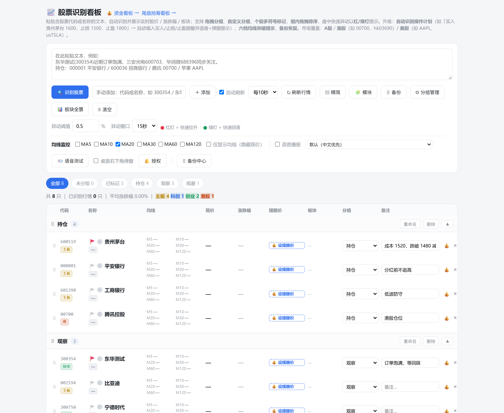
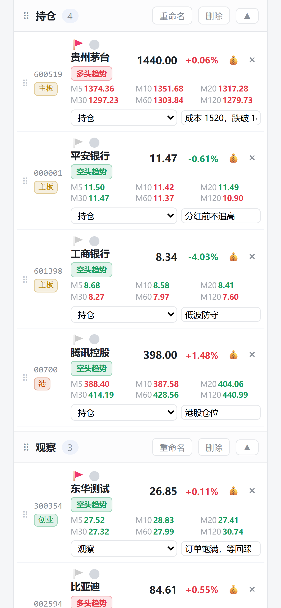
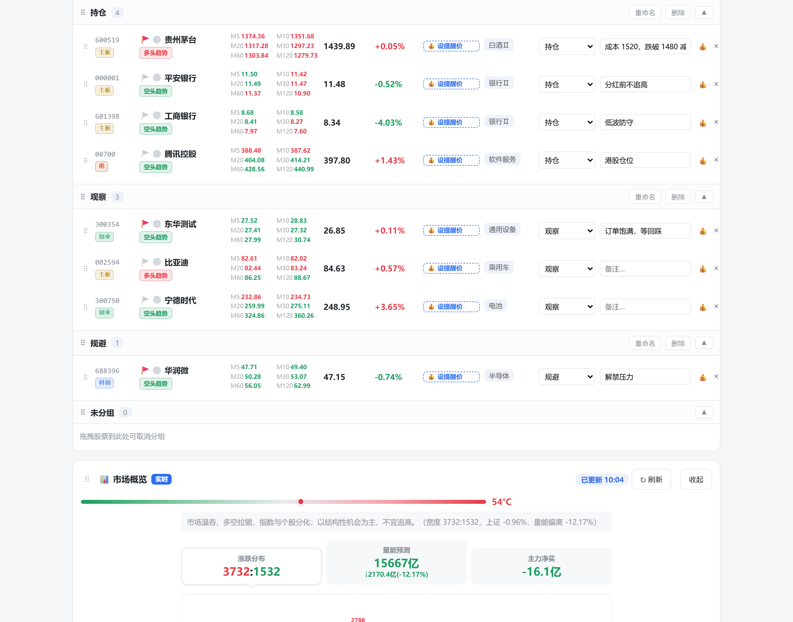
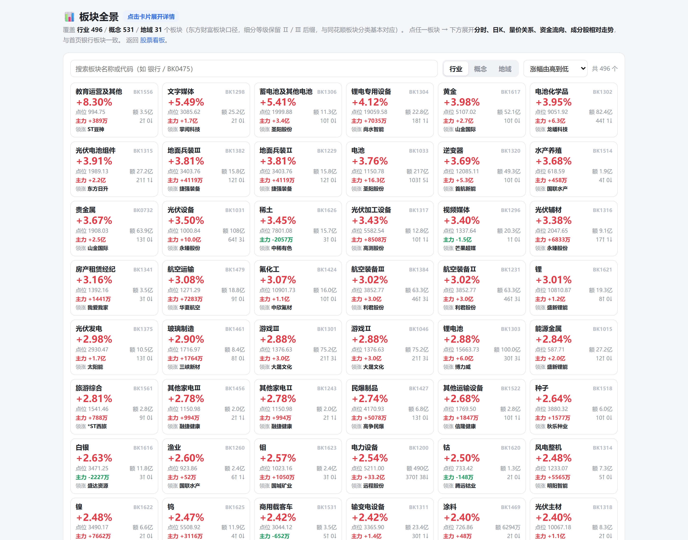
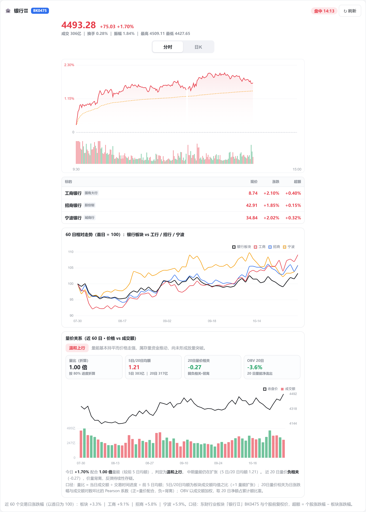
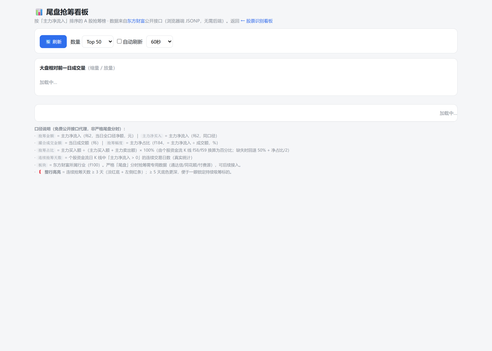
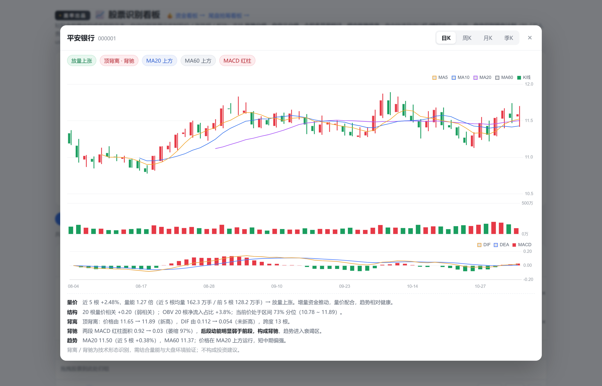
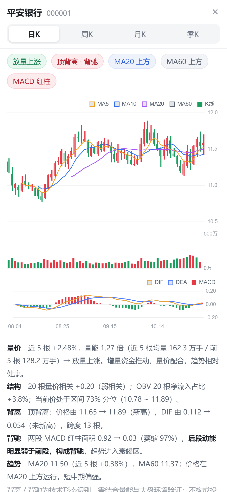

# 📈 股票识别看板 · StockBoard

> 粘贴一段带股票代码或名称的文本，自动识别成自选股，然后实时盯着它们的**价格 / 涨跌幅 / 板块 / 均线 / 到价提醒**。
> 纯静态单页，无需安装、无需构建、无需后端；A股 · 港股 · 美股都能看。

一个给自己用的盘中看盘台：不用注册、不用登录、数据只存在浏览器本地。适合盯十几到几十只票、需要分组管理、需要「跌到某价叫我」的场景。

> **盖率出品** · 自用工具，顺手开源。

---

## 截图

| 主看板（桌面） | 手机端 |
|---|---|
|  |  |

| 精简模式（紧凑行高） | 板块全景 |
|---|---|
|  |  |

| 银行板块观察 | 尾盘抢筹 |
|---|---|
|  |  |

| 点开个股：K 线 + 量能 + MACD + 背离判断 | 手机端全屏 |
|---|---|
|  |  |

---

## 它解决什么问题

大部分看盘软件的自选股是「一大坨」：加进去就乱、想按持仓/观察/规避分开要付费、想给每只票写一句自己的理由没地方写、跌到关键价位不会主动喊你。

这个工具把这些拆开各做一件小事：

- **一句话录入**：从聊天记录、研报、微信里复制一段话丢进去，自动把里面的股票识别出来（按代码、按名称、按 `hk00700` / `AAPL` 这类写法都认）。
- **分组是我的，不是软件给的**：持仓 / 观察 / 规避 / 自定义，拖拽就能改，组内也能拖动排序。
- **每只票有自己的备注**：成本、加减仓条件、听谁说的，写在行内，跟着数据一起存本地。
- **到价就喊**：买入价、止损价、止盈价，触发时闪烁 + 语音 + 桌面通知。
- **板块不再是空白**：每只票旁边直接显示东财行业板块，缺失会明确提示可点击重试，而不是默默留个「—」。

---

## 功能一览

### 1. 文本识别 / 手动添加
- 粘贴任意文本，识别其中的 A股（沪深主板 / 创业板 / 科创板 / 北交所）、港股、美股
- 名称识别基于内置字典（`stocks.js`，约 5000 只 A 股）+ 在线兜底解析新股
- 支持 `000001`、`平安银行`、`hk00700`、`00700`、`AAPL`、`usTSLA` 等写法
- 手动输入单个代码/名称直接添加

### 2. 分组与排序
- 默认「持仓 / 观察 / 规避」，可新建、重命名、删除
- 拖拽个股跨组移动，组内拖拽排序
- 多符号标记（★ ☆ ✕ 等），顶部 chips 可按标记 / 分组 / 未分组快速筛选

### 3. 实时行情
- 价格、涨跌幅、成交额、换手，默认 **10 秒**刷新（可选 5 / 10 / 30 / 60 秒，也可关自动刷新手动刷）
- 六档均线 MA5 / 10 / 20 / 30 / 60 / 120，与现价对比一眼看出多空
- 「仅显示均线」模式：隐藏现价，只看均线排列
- 一键切换「精简模式」：行高压缩，一屏能多看一倍标的

### 4. 异动提示
- 阈值可调（默认 0.5%），窗口可调（默认 15 秒）
- 🔴 快速拉升 / 🟢 快速回落，用行内闪烁 + 角标提示
- 盘中不用盯，跳出来的那一下会被标记住

### 5. 点击个股 → K 线研判（日 / 周 / 月 / 季）
点一下股票名或代码，弹出该股的 K 线研判面板：

- **三种图一次给全**：K 线（含 MA5/10/20/60）+ 成交量 + MACD(12,26,9)
- **周期可切**：日K / 周K / 月K / 季K，各取最近 60 根（季K 覆盖约 15 年）
- **量价关系判断**：近 5 根涨跌幅 vs 量能倍数（放量上涨 / 缩量上涨 / 放量下跌 / 缩量下跌）+ 20 根量价相关系数 + OBV 20 根净流入占比 + 当前价区间分位
- **MACD 背离**：自动找两个同向极值点，后高点价格创新高但 DIF 未新高 → 顶背离；低点反之 → 底背离
- **背驰判定**：比较两段同向 MACD 柱面积，后段萎缩到前段 78% 以下判为背驰（趋势衰竭）
- 周 / 月 / 季 K 由日线本地聚合（自然周 / 自然月 / 自然季），不是另拉一份数据
- 长周期用**不复权**数据：腾讯前复权在 2016 年前会把老价格算成负数，直接画季K 会把 y 轴拉垮

### 6. 到价提醒 + 均线提醒
- 每只票可设置 **买入价 / 止损价 / 止盈价**，触发时：卡片提醒 + 语音播报 + 桌面通知（需授权）
- **粘贴操作计划自动填充**：粘进「买入贵州茅台 1600，止损 1500，止盈 1800」，自动填好三个提醒价
- 六档均线「上穿 / 下破」也可作为触发条件，可只在交易时段内生效
- 语音可试听、可指定音色（优先中文）

### 7. 板块列 + 板块全景
- 每只票右侧显示东财行业板块（如「白酒Ⅱ」「银行Ⅱ」「乘用车」）
- 板块名批量拉取（一次请求多只，不逐只打接口），带本地缓存
- 拉取失败不再静默显示「—」，而是显示可点击的 **⟳ 重试**；历史脏缓存会自动清理并重新拉取
- 基金 / 北交所标的按数据源能力标注（「基金」「北交所」），不做无意义重试
- 独立的 **板块全景页**（`sectors.html`）：行业 496 / 概念 531 / 地域 31 个板块，按涨幅排序，点开看分时、日K、量价、资金流向

### 8. 资金 / 市场模块
- **市场概览**：主要指数、涨跌家数分布
- **成交额对比**：本日累计成交额 vs 前一交易日同时点，副图为每分钟量差（红放量 / 绿缩量）
- **ETF 轮动**：159915 ↔ 513100 相对走势，可缩放
- **银行板块观察**：板块分时 / 日K、工行·招行·宁波银行三只代表股对比、60 日相对走势、量价关系与 OBV

### 9. 尾盘抢筹看板（`tailbuy.html`）
- 主力净流入排序、连续抢筹、主力净占比
- 结合大盘缩量判断，用于尾盘选票参考

### 10. 数据都在你手里
- 全部状态存 `localStorage`，不经过任何第三方服务器
- **备份中心**：自动快照（30 分钟间隔、保留 10 份）+ 手动快照 + 一键恢复
- **导出 / 导入 JSON**：换电脑、换浏览器直接搬
- 模块可拖动排序、可折叠、可隐藏；模块位置和折叠状态也会被记住

---

## 快速开始

### 方式一：直接双击打开（零部署）

下载仓库，双击 `index.html` 即可。`file://` 下会自动走 JSONP / 直连模式，A股行情与日K 基本可用。

> 限制：板块全景页和部分资金模块依赖跨域请求，浏览器会拦截，`file://` 下不可用。

### 方式二：本地起个静态服务

```bash
cd stockboard
python -m http.server 8000
# 打开 http://localhost:8000/
```

同样没有 `/api/` 反代，直连模式，适合先看看效果。

### 方式三：部署到自己的服务器（推荐，功能完整）

静态文件丢进站点目录，再配一层**同源反代**（见下一节）。线上演示：`http://101.43.83.23/stockboard/`（个人实例，随时可能下线）。

---

## 为什么需要同源反代

腾讯 / 东财的行情接口有两个现实问题：

1. **跨域**：浏览器直连拿不到响应，只能退回 JSONP，而 JSONP 只支持 GET 且不好处理错误。
2. **WAF 按 IP 段拦截**：云主机 / 部分宽带出口 IP 会被拦，表现为接口 501 或直接空响应——服务器侧却完全正常。

所以前端写了一套「**同源优先，直连兜底**」的策略：

```js
const SAME_API = (location.protocol === 'http:' || location.protocol === 'https:') ? '/api/' : null;
```

有 `/api/` 就用它（快、稳、无跨域、可缓存），连续失败若干次自动降级直连；`file://` 下直接用直连。三种环境（自有服务器 / 静态托管 / 本地文件）都能跑。

反代示例见 [`docs/nginx-proxy.example.conf`](docs/nginx-proxy.example.conf)，只放行固定前缀、只允许 GET、带 15 秒本地缓存，避免沦为开放代理。

```nginx
location ^~ /api/qq/ {
    limit_except GET { deny all; }
    rewrite ^/api/qq/(.*)$ /$1 break;
    proxy_pass https://proxy.finance.qq.com;
    proxy_ssl_server_name on;
    proxy_set_header Host proxy.finance.qq.com;
    proxy_set_header User-Agent "Mozilla/5.0 ...";
    proxy_set_header Referer "https://gu.qq.com/";
    proxy_hide_header Access-Control-Allow-Origin;
    add_header Access-Control-Allow-Origin "*" always;
}
```

> 东财源站会按 TLS 指纹拦 nginx 直连。如果你的环境遇到 502 / `upstream prematurely closed connection`，可以用 [`tools/em-gw.py`](tools/em-gw.py) 起一个本地小网关（curl 转发 + 内存缓存），nginx 反代到 `127.0.0.1:8099` 即可。部署细节见 [`docs/DEPLOY.md`](docs/DEPLOY.md)。

---

## 数据来源

| 用途 | 接口 | 说明 |
|---|---|---|
| A股/港股/美股实时报价 | `qt.gtimg.cn` | 腾讯行情，GBK 编码 |
| 分时 / 日K（前复权） | `proxy.finance.qq.com` `newfqkline` | 日K 默认前复权 |
| 分时明细 / 逐分钟成交额 | `web.ifzq.gtimg.cn` | 资金看板的 A/B 对比口径 |
| 行业板块 | `push2.eastmoney.com/api/qt/ulist.np/get`（`f100`） | 批量拉取，一次多只 |
| 板块列表 / 板块行情 | `push2.eastmoney.com` | 行业 / 概念 / 地域 |
| 板块日K / 历史资金 | `push2his.eastmoney.com` | 前复权 |
| 主力净流入 / 涨跌分布 | `push2.eastmoney.com` / `push2ex.eastmoney.com` | `f62` 当日主力净额 |

所有行情均为**第三方公开接口**，非官方授权数据源；接口随时可能变更或限流。

---

## 目录结构

```
stockboard/
├── index.html                 # 主看板（单文件，含全部样式与逻辑）
├── sectors.html               # 板块全景页
├── tailbuy.html               # 尾盘抢筹看板
├── kline-panel.js             # 个股 K 线研判（日/周/月/季 + 量价 + MACD 背离背驰）
├── bank-panel.js              # 银行/板块观察模块（分时·日K·相对走势·量价）
├── fund-panel.js              # 资金看板模块（成交额对比·指数·ETF·涨跌分布）
├── stocks.js                  # A股代码/名称字典（构建期生成，约 5000 条）
├── chart.umd.min.js           # Chart.js 4
├── chartjs-plugin-zoom.min.js # 缩放/平移插件
├── hammer.min.js              # 手势库（移动端缩放）
├── docs/
│   ├── DEPLOY.md              # 部署与反代说明
│   ├── nginx-proxy.example.conf
│   └── screenshots/
└── tools/
    └── em-gw.py               # 东财本地网关（可选，应对 TLS 指纹拦截）
```

---

## 已知限制

- **没有后端就无法 100% 稳定**：直连模式依赖第三方接口的跨域策略与 IP 段，随时可能失效；要长期稳定请自建反代。
- **北交所板块为空**：东财对北交所个股不返回行业板块字段，页面标注「北交所」而非报错。
- **基金不显示板块**：同理，标注「基金」。
- **数据只在本机**：换设备要手动导出/导入；清理浏览器数据会丢自选股（建议开启自动快照）。
- **非交易时段**：价格停在收盘价，异动与提醒不会触发。
- 界面为简体中文，未做 i18n。

---

## 免责声明

本项目仅用于个人学习与技术研究，**不构成任何投资建议**。行情数据来自第三方公开接口，可能存在延迟、缺失或错误，请勿作为交易决策的唯一依据。据此操作，风险自负。

---

## License

代码以 [MIT](LICENSE) 协议开源。

第三方依赖各自遵循其原始协议：Chart.js（MIT）、chartjs-plugin-zoom（MIT）、Hammer.js（MIT）。`stocks.js` 为公开证券代码/名称字典，仅含代码与简称。

---

## 更新日志

- **v1.6** 新增个股 K 线研判面板（日/周/月/季 × K线·量能·MACD × 量价关系 × 背离背驰）；页面加「盖率出品」抬头
- **v1.5** 图表悬浮提示对比度修复（原深色文字压在半透明黑底上几乎看不清 → 统一改为不透明深底 + 亮字，圆角细边框）
- **v1.4** 板块列修复（批量拉取 + 脏缓存自愈 + 可点重试）；备注输入不再被打断（编辑会话期间提醒暂存、退出后合并补发）
- **v1.3** 备份中心、模块自由拖动 / 折叠 / 隐藏、精简模式
- **v1.2** 板块全景页、银行板块资金观察、尾盘抢筹看板
- **v1.1** 日K 前复权修复、六档均线、操作计划自动识别
- **v1.0** 文本识别 + 分组拖拽 + 异动闪烁 + 到价提醒
